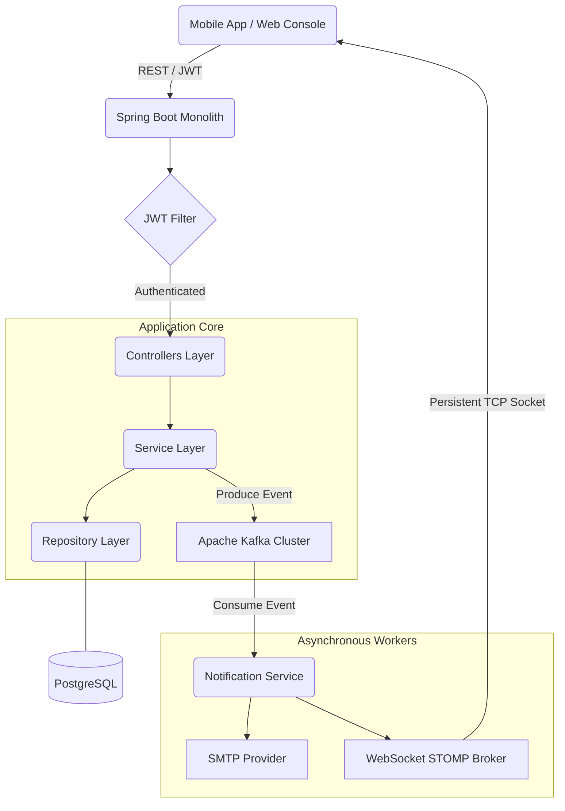

# 📦 Inventory & Order Management System

[](https://spring.io/projects/spring-boot)
[](https://www.oracle.com/java/)
[](https://www.postgresql.org/)
[](https://kafka.apache.org/)
[](https://redis.io/)
[](LICENSE)

A high-performance, event-driven Inventory and Order Management System built with **Spring Boot 4.0.4** and **Java 25**. This system is designed for high concurrency, real-time updates, and robust data integrity, featuring a modern microservices-adjacent monolithic architecture.

---

## 🚀 Key Features

- **⚡ High Concurrency**: Managed via **Optimistic Locking** to prevent race conditions during inventory updates.
- **🏗️ Event-Driven Architecture**: Fully decoupled services using **Apache Kafka** for reliable notification delivery.
- **🔔 Real-time Notifications**: Instant UI updates via **WebSockets (STOMP)** and asynchronous **Email** delivery.
- **🔐 Secure API**: Stateless authentication using **JWT** with role-based access control (Admin vs. Mobile).
- **🚀 Performance Optimized**: Integrated **Redis Caching** to minimize database load for frequently accessed data.
- **📦 Reliable Data Migrations**: Automated schema evolution with **Flyway**.
- **📊 Observability**: Ready for production with **Spring Boot Actuator** and **Prometheus** metrics.

---

## 🛠️ Tech Stack

| Category | Technology |
| :--- | :--- |
| **Framework** | Spring Boot 4.0.x / Java 25 |
| **Database** | PostgreSQL 15 |
| **Message Broker** | Apache Kafka / Zookeeper |
| **Caching** | Redis |
| **Security** | Spring Security / JWT (jjwt) |
| **ORM** | Spring Data JPA / Hibernate |
| **API Docs** | Swagger / OpenAPI 3 |
| **Tooling** | Lombok, MapStruct, Maven |
| **Infrastructure** | Docker, Docker Compose |

---

## 📐 Architecture Overview

The system follows a **Domain-Driven Design (DDD)** layered approach, ensuring separation of concerns and high maintainability.

### Request Flow Diagram



---

## 📁 Project Structure

```text
inventory-order-system/
├── src/
│   ├── main/
│   │   ├── java/com/example/inventory_order_system/
│   │   │   ├── config/          # Infrastructure configurations (Security, Kafka, WS)
│   │   │   ├── controller/      # API Endpoints (Admin, Mobile, Auth)
│   │   │   ├── dto/             # Data Transfer Objects
│   │   │   ├── entity/          # JPA Domain Models
│   │   │   ├── exception/       # Global Error Handling
│   │   │   ├── mapper/          # MapStruct Translators
│   │   │   ├── repository/      # Data Access Layer
│   │   │   └── service/         # Core Business Logic
│   │   └── resources/
│   │       ├── db/migration/    # Flyway SQL Scripts
│   │       └── application.yml  # Main Configuration
├── docker/                      # Docker setup artifacts
├── docker-compose.yml           # Infrastructure orchestration
├── pom.xml                      # Maven Dependencies
└── README.md                    # This File
```

---

## 🏁 Getting Started

### Prerequisites

- **Java 25** installed
- **Docker & Docker Compose**
- **Maven** (or use the provided `./mvnw`)

### 1. Clone the Repository
```bash
git clone https://github.com/Muhammad-Absar-ul-Haque/Inventory-Management-Backend-Spring-boot.git
cd inventory-order-system
```

### 2. Infrastructure Setup
Start the required services (PostgreSQL, Kafka, Zookeeper, Redis) using Docker Compose:
```bash
docker-compose up -d
```

### 3. Build & Run the Application
The application will automatically run Flyway migrations on startup.
```bash
./mvnw clean install
./mvnw spring-boot:run
```

---

## 📖 API Documentation

Once the application is running, you can access the interactive Swagger documentation at:

🔗 **[http://localhost:8080/swagger-ui/index.html](http://localhost:8080/swagger-ui/index.html)**

### Main API Scopes:
- **Admin APIs**: `/api/v1/admin/**` (Requires `ROLE_ADMIN`)
- **Mobile APIs**: `/api/v1/mobile/**` (Requires authenticated user)
- **Auth APIs**: `/api/v1/auth/**` (Public - Register/Login)

---

## 🚦 Testing

Run the full suite of unit and integration tests (including **Testcontainers** for DB and Kafka):
```bash
./mvnw test
```

---

## 📄 License
Distributed under the MIT License. See `LICENSE` for more information.
