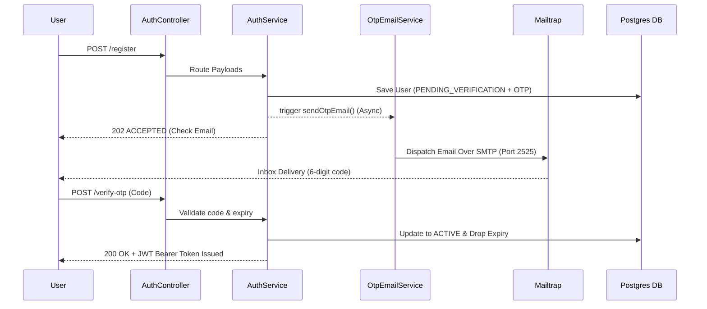

# API Execution Flow Guide
Use this guide to test the end-to-end functionality of your application from start to finish. If you execute these API calls in this exact order, you will successfully simulate a real-world scenario verifying your Database, Kafka brokers, and WebSockets.

---

## The Complete Walkthrough Scenario

### Phase 1: Setup and Inventory
You need an admin to create stock, and a customer to buy the stock.

**Step 1: Register a Customer**
*   **Action**: `POST /api/v1/mobile/auth/register`
*   **Body**: `{"fullName": "Alice", "email": "alice@test.com", "password": "pass"}`
*   **Result**: You will get a 202 Accepted alongside a message instructing you to check your email. You will **not** receive your token yet.

**Step 1.b: Extrapolate OTP from Mailtrap**
*   **Action**: Open your Mailtrap Inbox. Look for the "Your Verification OTP Code" email.
*   **Result**: Copy the 6-digit code.

**Step 1.c: Verify and Unlock**
*   **Action**: `POST /api/v1/mobile/auth/verify-otp`
*   **Body**: `{"email": "alice@test.com", "otp": "YOUR_6_DIGIT_CODE"}`
*   **Result**: *Now* you will receive your JWT response! Save the `token`. This is your **Customer Token**.

**Step 2: Login as Admin**
*   *(Note: The admin account usually needs to be seeded directly in the database or via an admin-creation script since public registration defaults to Customer).*
*   **Action**: `POST /api/v1/mobile/auth/login`
*   **Body**: `{"email": "admin@yourdomain.com", "password": "adminpassword"}`
*   **Result**: Save the `token` from the response. This is your **Admin Token**.

**Step 3: Admin Adds a Product**
*   **Action**: `POST /api/v1/admin/products`
*   **Headers**: `Authorization: Bearer <Admin Token>`
*   **Body**: 
    ```json
    {
      "name": "Mechanical Keyboard",
      "sku": "KB-01",
      "price": 99.99,
      "stockQuantity": 10
    }
    ```
*   **Result**: Note the `id` returned (e.g., `1`). This verifies your Admin Security and PostgreSQL write capability.

---

### Phase 2: Customer Browsing and Checkout

**Step 4: Customer Browses Products**
*   **Action**: `GET /api/v1/mobile/products`
*   **Headers**: `Authorization: Bearer <Customer Token>`
*   **Result**: You should see the "Mechanical Keyboard" in the list.

**Step 5: Customer Places an Order**
*   **Action**: `POST /api/v1/mobile/orders`
*   **Headers**: `Authorization: Bearer <Customer Token>`
*   **Body**: 
    ```json
    {
      "items": [
        { "productId": 1, "quantity": 1 }
      ]
    }
    ```
*   **Result**: You should get a 201 Created and an Order ID (e.g., Order `id`: `1`). 
*   *Verification*: If you run Step 4 again, the stock quantity in the database will now correctly be `9` instead of `10`.

---

### Phase 3: Fulfillment and Event-Driven Notifications (Kafka + WebSockets)

**Step 6: Customer Connects to WebSocket**
*   *Before you ship the item, you must wait for it!*
*   **Action**: Open your frontend app or a WebSocket test client (like Postman or Hoppscotch).
*   **Connect to**: `ws://localhost:8080/ws/notifications`
*   **Authentication**: Ensure you pass `Authorization: Bearer <Customer Token>` in your `CONNECT` stomp headers.
*   **Subscribe**: Subscribe to the channel `/user/queue/notifications`.

**Step 7: Admin Fulfils the Order**
*   **Action**: `PATCH /api/v1/admin/orders/1/status` (Assuming order ID is 1).
*   **Headers**: `Authorization: Bearer <Admin Token>`
*   **Body**: `{"status": "DELIVERED"}`
*   **Result**: Returns 200 OK immediately for the Admin.

**Step 8: Watch the Magic Happen**
The moment Step 7 executes, the following cascade occurs completely automatically:
1.  The HTTP request in Step 7 fires a message into **Apache Kafka**.
2.  Your `NotificationService` backend consumer reads Kafka.
3.  Your web socket client listening from Step 6 will **instantly** receive a JSON payload pop up on the screen saying: `"Dear Alice, your order #1 has been successfully delivered!"`.

**Step 9 (Optional Verification): View DB Notifications**
*   **Action**: `GET /api/v1/mobile/notifications`
*   **Headers**: `Authorization: Bearer <Customer Token>`
*   **Result**: You will permanently see a log of the sent notification safely stored in your database.

--- 

### Security & Architecture Walkthrough (Mermaid)



---
### Expected Outcome
By running these exact actions in sequence, you verify your entire micro-architecture including the brand new Mailtrap configurations. If all of these pass successfully, your Security, Database Logic, OTP Asynchronous Logic, Optimistic Locking, Kafka Producer/Consumer, and WebSocket router are flawless!
