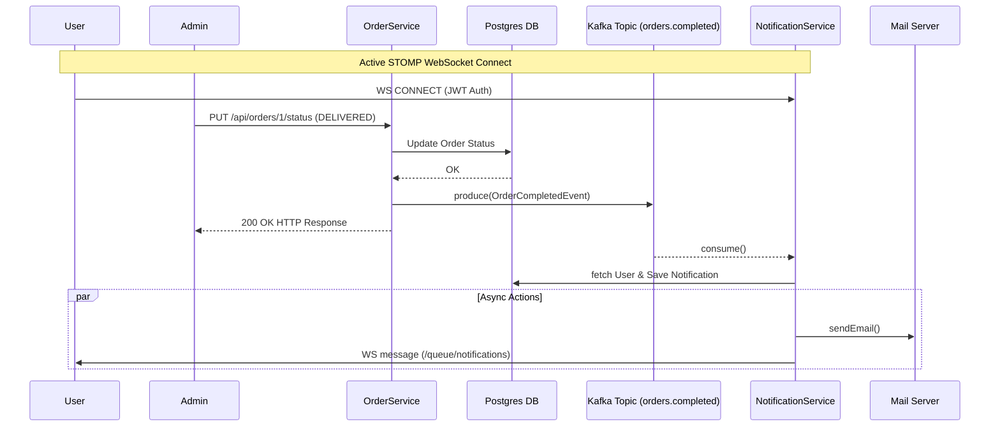

# Kafka & WebSocket Integration Deep Dive
**Spring Boot Inventory Management System**

---

## 1. Introduction

Welcome to the internal documentation for the Inventory Management System. This project handles user orders, stock management, and real-time notifications. 

The two crucial asynchronous technologies driving the system are **Apache Kafka** and **WebSockets**. 
* **Kafka** serves as the message broker that decouples synchronous operations (like updating an order status) from heavy asynchronous side-effects (like sending emails and notifications).
* **WebSockets** provide a persistent, bi-directional connection between the server and the frontend client, enabling real-time push notifications without the need for constant HTTP polling.

## 2. Current Project Analysis (Based on My Code)

The system revolves around two primary modules concerning this integration:
* **Order Module (`OrderService.java`)**: Handles order placement and status updates. It acts as the *source* of truth and the origin of our event-driven flow.
* **Notification Module (`NotificationService.java`)**: Handles user communication. It acts as the *consumer* of events, processing data and pushing updates via Email and WebSockets.

**The Current Flow:**
When an administrator or system process updates a user's order to `DELIVERED`, the `OrderService` captures this change. Instead of making the user wait while the system sends an email and pings a WebSocket connection, it drops an `OrderCompletedEvent` into a Kafka topic. The `NotificationService` independently picks up this event and handles the WebSocket push to the user.

---

## 3. Kafka Implementation in My Project

### 3.1 Producer Flow

* **Where it's implemented:** `OrderService.java`
* **Which methods send messages:** `publishOrderCompletedEvent(Order order)` which is invoked inside `updateOrderStatus(Long orderId, OrderStatusUpdateRequest request)`.
* **When messages are triggered:** A message is triggered strictly when the order status is updated to `OrderStatus.DELIVERED`. 

```java
// Snippet from OrderService.java
if (order.getStatus() == OrderStatus.DELIVERED) {
    publishOrderCompletedEvent(order);
}
// ...
kafkaTemplate.send(KafkaConfig.TOPIC_ORDERS_COMPLETED, String.valueOf(order.getId()), event);
```

### 3.2 Consumer Flow

* **Where it's implemented:** `NotificationService.java`
* **What happens when a message is received:** The `@KafkaListener` deserializes the event. The system fetches the user from the database, constructs a message string (`"Dear Name, your order #123 has been successfully delivered..."`), and saves a `Notification` entity to the database in a `PENDING` state.
* **How it pushes updates:** It triggers `sendEmail` and `sendWebSocketMessage`. Depending on the success of these operations, it updates the notification status to `SENT` or `FAILED`.

### 3.3 Topics and Message Structure

* **Topics configured in `KafkaConfig.java`:**
  * `orders.completed` (`TOPIC_ORDERS_COMPLETED`): Partitions: 3, Replicas: 1
  * `orders.placed` (`TOPIC_ORDERS_PLACED`): Partitions: 3, Replicas: 1
* **Payload Structure (`OrderCompletedEvent.java` DTO):**
  * `orderId` (Long)
  * `userId` (Long)
  * `totalPrice` (BigDecimal)
  * `items` (List of `OrderItemEvent` containing `productId`, `quantity`, `priceAtPurchase`)

---

## 4. Kafka Message Lifecycle (Trace Example)

Let's trace a real flow when an Order API updates a status:

1. **REST API Call:** `PUT /api/orders/{id}/status` -> `request.setStatus("DELIVERED")`.
2. **OrderService (`updateOrderStatus`):** Order status is updated in PostgreSQL. Method calls `publishOrderCompletedEvent`.
3. **Kafka Producer (`KafkaTemplate`):** The `KafkaTemplate` serializes the `OrderCompletedEvent` to JSON and sends it to the `orders.completed` topic. The order ID (`String.valueOf(order.getId())`) is used as the Kafka message key.
4. **Kafka Topic (`orders.completed`):** Kafka routes the message to one of the 3 partitions (hashed by the order ID, ensuring events for the same order stay in order).
5. **Kafka Consumer (`NotificationService`):** The `@KafkaListener` running in the `spring.kafka.consumer.group-id` consumer group polls the topic, finds the new message, and deserializes it back into an `OrderCompletedEvent` object.
6. **Notification Processing:** The database is queried for the user, an email is fired, and a WebSocket payload is dispatched down the pipe to the user's browser.

---

## 5. Internal Kafka Working (Mapped to My Project)

* **Partitioning:** In `KafkaConfig`, `ordersCompletedTopic()` defines `partitions(3)`. Because `OrderService` passes the Order ID as the message key (`kafkaTemplate.send(..., String.valueOf(order.getId()), ...)`), Kafka guarantees that all events for a specific Order ID always go to the same partition.
* **Consumer Groups:** Defined via `@KafkaListener(groupId = "${spring.kafka.consumer.group-id}")`. If you ran 3 instances of this Spring Boot app, Kafka would assign 1 partition to each instance. They would share the load. If you run 1 instance, it consumes from all 3 partitions.
* **Offset Management:** Spring Kafka defaults to auto-committing offsets once the `@KafkaListener` method completes without throwing an exception.
* **Failures/Restarts:** Because the `@Transactional` annotation is on `handleOrderCompletedEvent`, if `userRepository.findById` fails or crashes, the offset is not committed. Upon restart, Kafka will re-deliver the message.

---

## 6. WebSocket Implementation in My Project

### 6.1 Configuration

* **Where it's configured:** `WebSocketConfig.java`
* **Broker Setup:** STOMP over WebSockets. Enabled via `@EnableWebSocketMessageBroker`.
  * `enableSimpleBroker("/topic", "/queue", "/user")`
  * Application prefix: `/app`
  * STOMP Endpoint: `/ws/notifications` (with SockJS fallback, allowing all CORS origins `*`).

### 6.2 Message Flow

* **Where messages are sent:** `NotificationService.java` -> `sendWebSocketMessage()`
* **Trigger:** Instigated downstream by the Kafka message being processed.
* **Implementation:** Uses `SimpMessagingTemplate.convertAndSendToUser(username, "/queue/notifications", message)`.

### 6.3 Frontend Communication

* **Topics Used:** By using `convertAndSendToUser` with the destination `/queue/notifications`, Spring converts this under-the-hood to exactly target a specific user session. The frontend must subscribe to `/user/queue/notifications`.
* **Security & Auth:** The `WebSocketConfig` intercepts incoming STOMP connections. It intercepts `StompCommand.CONNECT`, extracts the JWT from the `Authorization: Bearer <token>` header, parses the username, and attaches a `UsernamePasswordAuthenticationToken` to the WebSocket session. This establishes *who* the user is so Spring knows exactly which socket to pipe the `/user/...` message to.

---

## 7. Kafka + WebSocket Integration

**The Bridge:** `NotificationService` is the bridge. It implements the `@KafkaListener` and injects the `SimpMessagingTemplate`.

**Full Real-Time Flow:**
1. **Admin / System:** Updates Order to `DELIVERED`.
2. **OrderService:** Saves to DB -> Sends Event to **Kafka** `orders.completed` topic.
3. **Kafka Broker:** Holds the message.
4. **NotificationService:** Polls Kafka, receives the message.
5. **NotificationService:** Parses the data, wraps the notification text, and uses **WebSocket** (`messagingTemplate`) to push to the connected user's queue.
6. **Frontend App:** Instantly receives the JSON payload over its active STOMP connection and shows a "toast" UI notification to the user without needing to refresh the page.

---

## 8. Why This Architecture?

* **Why Kafka instead of REST API calls between modules?**
  Updating an order status should be instant for the caller. If `OrderService` synchronously called an external Email provider or waited on a slow WebSocket framing write, the database transaction would take too long. Kafka allows the API to return `200 OK` in milliseconds while the heavy lifting happens in the background.
* **Why WebSocket instead of polling?**
  If a user keeps a tab open to see their order status, making a REST call every 5 seconds (polling) wastes bandwidth and DB resources. WebSockets maintain a single open TCP connection, resulting in zero overhead until the server *pushes* data perfectly right when it's ready.
* **Why both together?**
  Kafka handles *Server-to-Server* decoupling and resilience. WebSockets handle *Server-to-Client* real-time capability. Kafka makes sure the notification doesn't get lost if an email provider goes down, and WebSockets make sure the user gets it instantly when it does fire.

---

## 9. Real-World Issues & Analysis of My Code

* **Duplicate Message Risks:** Spring Kafka defaults to at-least-once delivery. If `handleOrderCompletedEvent` saves the `Notification` to the DB but crashes right after sending the WebSocket message (before committing the Kafka offset), it will process the event *again* on restart. The user might get two emails.
* **Idempotency Gaps:** The current `NotificationService` does not check if an `OrderCompletedEvent` for `orderId = 123` has already been processed before sending emails. You should ideally check if a `Notification` entity already exists for that user and order combination.
* **Coupling to Transactions:** `OrderService` publishes to Kafka *before* the Spring `@Transactional` block actually commits the order to PostgreSQL. If the DB fails to commit, the Kafka message is already gone! The consumer could try to process a notification for an order that rolled back. Consider using a `TransactionSynchronizationManager` to publish to Kafka only *after* DB commit.
* **Scaling Notifications:** Local `ConcurrentHashMap` WebSocket session trackers (which `enableSimpleBroker` uses) only know about users connected to the *current* Spring Boot instance. If you run 2 instances of this app, and User A is connected to Instance 1, but the Kafka message is consumed by Instance 2, the `convertAndSendToUser` on Instance 2 will silently do nothing. In an advanced environment, you would replace `enableSimpleBroker` with a full RabbitMQ/ActiveMQ STOMP relay.

---

## 10. Advanced Concepts (Mapped to My Project)

* **Event-Driven Architecture (EDA):** `OrderService` doesn't know `NotificationService` exists. It just knows "an order finished." This loose coupling ensures that you can add an `AnalyticsService` tomorrow that listens to the same `orders.completed` topic without touching `OrderService` code.
* **Fault Tolerance:** If the Email server goes offline, your `OrderService` stays up. The `NotificationService` might log errors or shut down its Kafka listener temporarily, but users can still place orders.
* **Partition Keys:** By passing `String.valueOf(order.getId())` as the Kafka Key, you guarantee order parity. If you later send an "Order Refunded" event, it hits the same partition, guaranteeing the consumer processes "Delivered" before "Refunded."

---

## 11. Visual Diagrams



---

## 12. Conclusion

The Inventory Management System elegantly uses Apache Kafka for background job dissociation and WebSockets for real-time frontend integration. By dispatching `OrderCompletedEvent`s into the broker, the system remains incredibly lightweight on the main execution threads. The `NotificationService` reliably absorbs those events, multiplexing updates to user emails and live browser instances via securely authenticated WebSocket sessions. This architecture is interview-ready, scalable, and built around professional event-driven paradigms.
